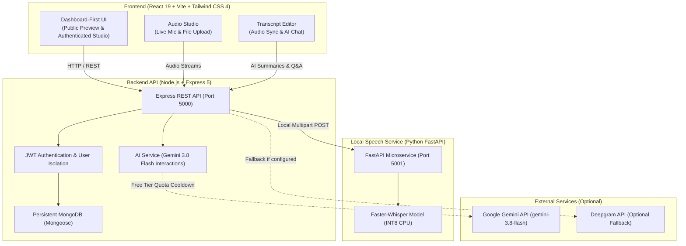

# SpeechScribe AI — Sovereign Speech Intelligence Workspace

[](LICENSE)
[](https://nodejs.org/)
[](https://react.dev/)
[](https://fastapi.tiangolo.com/)
[](https://github.com/SYSTRAN/faster-whisper)
[](https://ai.google.dev/)
[](https://www.mongodb.com/)
[](https://vitest.dev/)

**Live Production Preview:** [https://speechscribeai.netlify.app/](https://speechscribeai.netlify.app/)

---

## 1. Project Overview

**SpeechScribe AI** is a sovereign, full-stack speech intelligence workspace designed for high-precision voice transcription, speaker-synchronized editing, and contextual AI analysis.

Unlike conventional transcription SaaS tools that impose per-minute audio charges and leak private audio recordings to third-party clouds, SpeechScribe AI operates on a strict **₹0 budget philosophy**:
1. **Local Faster-Whisper INT8 Speech Engine:** Runs locally on host CPU via CTranslate2, delivering word-level timestamps, automatic language detection, and zero cloud egress.
2. **Google Gemini 3.8 Flash Interactions API:** Delivers on-demand executive summaries, key decisions, action items, and conversational transcript Q&A with built-in HTTP 429 quota cooldown protection.
3. **Dashboard-First Entry Experience:** Allows visitors and guest users to preview features, explore studio capabilities, and seamlessly authenticate via an in-place `AuthModal` with return-destination preservation.
4. **Persistent Multi-Tenant Storage:** Stores accounts and transcripts safely in persistent MongoDB storage with user data isolation (BOLA protection) and JWT session restoration.
5. **Editorial Visual Identity:** Styled in **Royal Amber (`#C87932`) × Warm Ivory (`#F8F5EF`) × Deep Charcoal (`#292929`)** with a **Dark Burnt Amber (`#542B17`) Navigation Sidebar**.

---

## 2. System Architecture

The application is structured into three coordinated tiers:



---

## 3. Key Features

- **🎙️ Live Audio Studio:** In-browser audio capture with live audio level visualization, 16 kHz sample rate optimization, and automatic audio blob encoding.
- **📁 Universal File Upload:** Drag-and-drop or browse audio files (`.mp3`, `.wav`, `.m4a`, `.aac`, `.webm`, `.flac`) with upload progress telemetry.
- **⚡ Faster-Whisper Local INT8 Engine:** Fast CPU-based inference utilizing CTranslate2 INT8 quantization with single-concurrency mutex to avoid CPU starvation.
- **🤖 Gemini 3.8 Flash Intelligence:** Generates structured executive summaries, key bullet points, and extracted action items. Provides contextual transcript Q&A with graceful HTTP 429 quota handling.
- **⏱️ Synchronized Interactive Editor:** Word-level timestamps, playback scrubbing, editable title and transcript text, speaker diarization tags, and one-click PDF export.
- **🛡️ Multi-Tenant User Isolation:** Passwords securely hashed with bcrypt. Endpoints strictly enforce tenant isolation so User A can never read, modify, or delete User B's records.
- **💾 Automatic MongoDB Persistence:** Automatically connects to existing MongoDB or spawns an embedded persistent MongoDB server in `server/data/db`, preserving all accounts and transcripts across restarts.
- **🔑 Session Restoration:** Seamless token refresh and session rehydration via `/api/auth/me` without flickering unauthenticated states.

---

## 4. Tech Stack

| Layer | Technologies |
|---|---|
| **Frontend** | React 19, Vite 7, Tailwind CSS 4, React Router 7, Lucide React, Framer Motion, Axios, jsPDF |
| **Backend API** | Node.js (ESM), Express 5, Mongoose 9, JWT, Bcrypt.js, Helmet, Express Rate Limit, Multer |
| **Speech Engine** | Python 3.10+, Faster-Whisper (CTranslate2), FastAPI, Uvicorn, PyAV |
| **AI Intelligence** | Google Gemini 3.8 Flash (`@google/genai` Interactions API) |
| **Database** | MongoDB (Local persistent storage in `server/data/db` or MongoDB Atlas) |
| **Testing** | Vitest 3, Supertest, MongoDB Memory Server (test isolation) |

---

## 5. Prerequisites

Before running the project, ensure you have installed:

1. **Node.js**: `v18.0.0` or higher (`v20+` or `v22+` recommended).
   - Check with: `node -v`
2. **Python**: `3.10`, `3.11`, or `3.12`.
   - Check with: `python --version` or `py --version`
3. **Git**: Installed and available in PATH.
   - Check with: `git --version`
4. **MongoDB (Optional)**: If you do not have a system MongoDB instance running, the backend automatically launches a persistent embedded MongoDB binary in `server/data/db`.

---

## 6. How to Run the Application

The application consists of three components that run concurrently:
1. **Python Speech Microservice** (Faster-Whisper on `http://127.0.0.1:5001`)
2. **Node.js Express Backend** (API on `http://localhost:5000`)
3. **React Client** (Frontend on `http://localhost:5173`)

### Option A: Running with Separate Terminals (Recommended)

#### Terminal 1 — Python Speech Microservice (Faster-Whisper)
The Python service runs the local speech-to-text inference engine on port 5001.

**On Windows (PowerShell):**
```powershell
cd server\python-service
.\venv\Scripts\Activate.ps1
python app.py
```

> [!TIP]
> **Verify Python Interpreter:**  
> Verify that the active `python` command points to the virtual environment rather than your global system Python:
> ```powershell
> (Get-Command python).Source
> ```
> Expected output: `...\server\python-service\venv\Scripts\python.exe`
> 
> If you execute `python app.py` without activating the virtual environment, Windows invokes the global Python interpreter which does not have `av` installed, producing: `ModuleNotFoundError: No module named 'av'`.

> [!NOTE]
> **PowerShell Script Execution Policy:**  
> If PowerShell blocks `Activate.ps1` with an execution policy error, enable script execution for your user account:
> ```powershell
> Set-ExecutionPolicy -ExecutionPolicy RemoteSigned -Scope CurrentUser
> ```
> Or invoke Python directly from the virtual environment without activation:
> ```powershell
> .\venv\Scripts\python.exe app.py
> ```
> *(Or double-click `server\python-service\start.bat`)*

**Installing / Updating Dependencies (if necessary):**
```powershell
# Ensure virtual environment is activated, then run:
pip install -r requirements.txt
```

**On macOS / Linux:**
```bash
cd server/python-service

# Create virtual environment
python3 -m venv venv

# Activate virtual environment
source venv/bin/activate

# Install requirements
pip install -r requirements.txt

# Start the service
python app.py
```
*Output will indicate:*
```
INFO: Loading Faster-Whisper model 'base' (device=cpu, compute_type=int8)...
INFO: Uvicorn running on http://127.0.0.1:5001
```

---

#### Terminal 2 — Node.js Backend API
The Express backend handles user authentication, persistent transcripts, and Gemini AI operations on port 5000.

```bash
cd server

# Install dependencies
npm install

# (Optional) Verify your server/.env file
# By default, a working development .env is already configured!

# Start the development server
npm run dev
```
*Output will indicate:*
```
Persistent MongoDB Connected: 127.0.0.1 (d:\speechsrcibe\server\data\db)
SpeechScribe API v2 running in development mode on port 5000
```

---

#### Terminal 3 — React Frontend Client
The Vite frontend serves the user interface on port 5173.

```bash
cd client

# Install dependencies
npm install

# Start the Vite development server
npm run dev
```
*Output will indicate:*
```
  VITE v7.3.1  ready in 450 ms

  ➜  Local:   http://localhost:5173/
  ➜  Network: use --host to expose
```

Now open **[http://localhost:5173](http://localhost:5173)** in your browser!

---

## 7. Pre-Configured Demo Credentials

To evaluate the application instantly without filling out a registration form, click the **"Fill Demo"** button on the Sign In page or use these credentials:

| Field | Value |
|---|---|
| **Email** | `alex.mercer@speechscribe.ai` |
| **Password** | `SpeechScribe2026!` |

*(You can also click **"Create Account"** or register any new user profile. All accounts persist safely across server restarts).*

---

## 8. Environment Variables Reference

### Backend Configuration (`server/.env`)

| Variable | Required | Default | Description |
|---|---|---|---|
| `PORT` | No | `5000` | Port for the Express REST API server |
| `NODE_ENV` | No | `development` | Environment mode (`development`, `production`, `test`) |
| `CLIENT_URL` | No | `http://localhost:5173` | Allowed CORS frontend origin |
| `MONGO_URI` | No | `mongodb://localhost:27017/speechscribe` | MongoDB connection string. If unavailable, auto-launches persistent local `mongod` |
| `JWT_SECRET` | Yes | *configured* | Secret key for signing JSON Web Tokens (min 32 characters) |
| `JWT_EXPIRES_IN` | No | `7d` | Token validity duration |
| `WHISPER_SERVICE_URL` | No | `http://127.0.0.1:5001` | URL of the local Python Faster-Whisper microservice |
| `GEMINI_API_KEY` | Optional | *configured* | Google Gemini API key for AI summaries and Q&A |
| `GEMINI_MODEL` | No | `gemini-3.8-flash` | Gemini model name (Interactions API) |
| `DEEPGRAM_API_KEY` | Optional | `null` | Optional cloud transcription fallback |

### Python Microservice Configuration (`server/python-service`)

| Variable | Default | Description |
|---|---|---|
| `WHISPER_MODEL` | `base` | Model size (`tiny`, `base`, `small`, `medium`) |
| `WHISPER_PORT` | `5001` | Microservice listening port |
| `HOST` | `127.0.0.1` | Localhost binding for process isolation |

### Frontend Configuration (`client/.env` - Optional)

| Variable | Default | Description |
|---|---|---|
| `VITE_API_URL` | `http://localhost:5000` | Base URL for backend API requests |

---

## 9. API Reference & Endpoints

All REST routes are prefixed with `/api`.

### Health Check
- `GET /api/health` — Returns system status, database connectivity, and engine telemetry (Public).

### Authentication (`/api/auth`)
- `POST /api/auth/register` — Register a new user account. Returns `{ user, token }`.
- `POST /api/auth/login` — Sign in with email and password. Returns `{ user, token }`.
- `GET /api/auth/me` — Retrieve current authenticated user profile (Bearer JWT required).

### Transcripts (`/api/transcripts`)
- `GET /api/transcripts` — Get paginated transcripts for the authenticated user (`?page=1&limit=20&search=...`).
- `GET /api/transcripts/:id` — Retrieve a specific transcript by ID (Owner only).
- `POST /api/transcripts` — Create a transcript directly.
- `PATCH /api/transcripts/:id` — Update transcript title or text.
- `DELETE /api/transcripts/:id` — Permanently delete a transcript.

### Audio & Speech Recognition (`/api/audio`)
- `POST /api/audio/recording` — Upload a browser-captured microphone audio recording.
- `POST /api/audio/upload` — Upload an audio file from disk.
- `POST /api/audio/transcribe` — Process audio directly through the local Faster-Whisper microservice.

### AI Intelligence Engine (`/api/ai`)
- `POST /api/ai/summarize/:id` — Generate executive summary, bullet points, and action items using Gemini 3.8 Flash.
- `POST /api/ai/ask/:id` — Contextual Q&A against the transcript text (`{ question: "..." }`).
- `GET /api/ai/quota` — Check Gemini 429 quota cooldown status and retry timer.

---

## 10. Automated Tests & Quality Assurance

SpeechScribe AI includes a Vitest test suite with end-to-end coverage across authentication lifecycles, user data isolation (BOLA protection), Faster-Whisper mock providers, and Gemini 429 quota handling.

### Running Backend Tests
```bash
cd server
npm test
```
*Suite summary:*
```
 ✓ tests/auth_lifecycle.test.js (8 tests)
 ✓ tests/api.test.js (17 tests)
 ✓ tests/ai.test.js (26 tests)
 ✓ tests/audio.test.js (13 tests)
 ✓ tests/speech.test.js (5 tests)

 Test Files  5 passed (5)
      Tests  69 passed (69)
```

### Building the Frontend for Production
```bash
cd client
npm run build
```

---

## 11. Troubleshooting & FAQs

### Q: Why am I seeing `ModuleNotFoundError: No module named 'av'` when running `python app.py`?
**A:** This occurs when `python app.py` is invoked using the global system Python instead of the dedicated project virtual environment where PyAV, Faster-Whisper, and FastAPI are installed.
To fix this, activate the virtual environment in PowerShell before running `app.py`:
```powershell
cd server\python-service
.\venv\Scripts\Activate.ps1
python app.py
```
Or run directly through the virtual environment's Python interpreter:
```powershell
cd server\python-service
.\venv\Scripts\python.exe app.py
```

### Q: Why is transcription returning "Local Faster-Whisper speech service is unavailable on 127.0.0.1:5001"?
**A:** The Python microservice has not been started. Open a terminal, navigate to `server/python-service`, activate your virtualenv, and run `python app.py` (or execute `server\python-service\start.bat` on Windows). Once it logs `Uvicorn running on http://127.0.0.1:5001`, transcription will execute instantly.

### Q: Where is my data stored?
**A:** Audio transcripts and user credentials are stored in your local persistent MongoDB directory at `server/data/db`. If you restart your computer or stop nodemon, all your transcripts and accounts remain intact.

### Q: How does Gemini AI Quota handling work?
**A:** Google Gemini 3.8 Flash free tier limits requests to 20 calls/day per project. When the daily limit is reached, the server detects the HTTP 429 response, enters a cooldown period, displays a clear countdown message in the UI, and automatically avoids hammering Google's API until the quota resets. Local Faster-Whisper transcription continues working 100% independently.

### Q: Can I run this without an internet connection?
**A:** Yes! The core transcription engine (Faster-Whisper INT8) and database (MongoDB) run entirely on your local machine with zero internet dependency. Only the optional Gemini AI summaries and Q&A require internet access.

---

## 12. License

This project is licensed under the **ISC License**.
